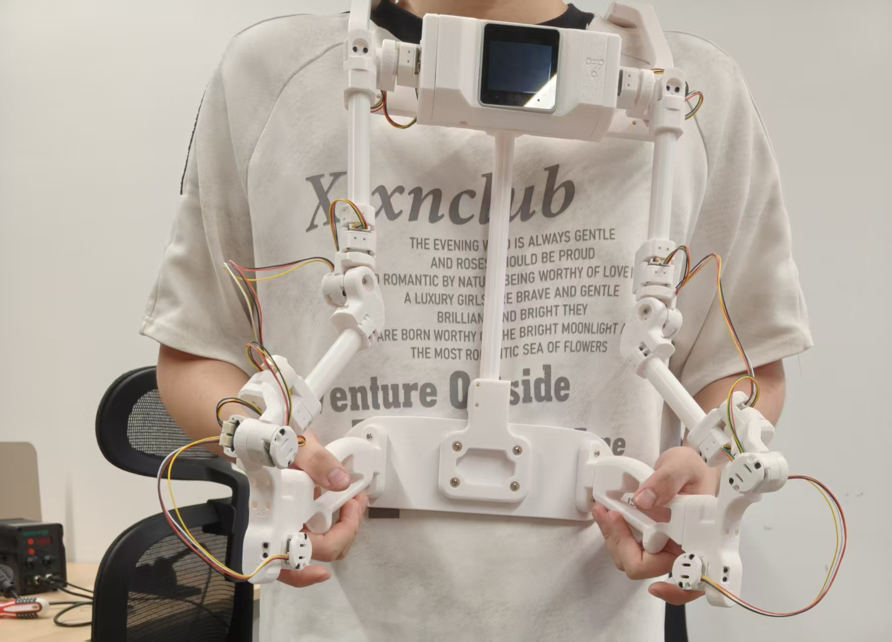

# KER Exoskeleton Replica

复刻 [OpenArm KER](https://docs.openarm.dev/)（Enactic, Apache 2.0 开源）遥操外骨骼的**结构改造与调试记录仓库**。双臂 16 通道角度数据链路已完全打通。



**English TL;DR** — This repo documents my rebuild of the OpenArm KER teleoperation exoskeleton: 16x TLE5012B magnetic encoders → ATtiny1616 → RS485 daisy-chain (2 Mbaud) → M5Stack CoreS3 → PC, working end-to-end with all 16 channels streaming. It contains my modified encoder firmware (a standalone-reply mode for bench bring-up, plus a PC-side bench diagnostic firmware), four re-designed structural parts (a slide-lock quick-release replacing the magnetic GoPro mount), and the debugging lessons behind them. All credit to Enactic's original Apache 2.0 project.

## 这是什么

我是一个结构工程师（非嵌入式背景）。这个仓库记录我复刻 OpenArm KER 遥操外骨骼的过程产物：**改过的固件、重新设计的结构件、以及一路踩坑的方法论**。

- 16 通道角度采集链路已全部打通：编码器板 ×16 → 主控 → PC 上位机，双臂 16 通道全部出数
- 结构件除铰链外全部使用拓竹 3D 打印 PLA——被动测量设备不传递扭矩，精度预算全部留给测量链
- 编码器安装误差 0.1–0.3 mm 级别不影响使用，零点标定会吸收随机偏置

## 技术架构

```
关节 ×16 ─→ TLE5012B 磁编码器 ×16（15bit 绝对角度）
                 │ SSC（类 SPI 单数据线）
             ATtiny1616 ×16（每关节一块编码器板，ID 1–16）
                 │ RS485 差分菊花链（2 Mbaud，半双工，接力应答）
             M5Stack CoreS3-SE（1 kHz 轮询采集）
                 │ USB
             PC 上位机（16 通道角度流）
                 │ （计划中：CAN → 意优电机 → 7 轴从手机械臂）
```

## 仓库内容

| 目录 | 内容 |
|---|---|
| `firmware/encoder/` | 编码器固件：原版 + 两个修改版，改动说明见 [MODIFICATIONS.md](firmware/encoder/MODIFICATIONS.md) |
| `cad/` | 重新设计的 4 个结构件（STEP 格式） |
| `photos/` | 实物照片 |
| `LICENSE.txt` | Apache 2.0（承袭自原项目） |
| `NOTICE` | 衍生来源声明 |

## 固件

| 文件 | 说明 |
|---|---|
| `main.cpp` | Enactic 原版固件，未改动（日常运行用这个） |
| `main.cpp.test` | **独立应答模式**：每板收到广播后按时隙（ID×60µs）各自应答，不依赖菊花链前驱——单块板、任意子集接上总线就能出数，台架调试利器 |
| `main.cpp.benchdiag` | **台架诊断固件**：115200 波特率 + ASCII 单字节命令，PC + 普通 USB-RS485 小尾巴即可区分 MCU / RS485 收发器 / 编码器芯片三类故障 |
| `platformio.ini` | 烧录配置。`DEVICE_ID` 按板子改，`upload_port` 按本机串口改 |

两个修改版的来龙去脉、逐条改动和命令用法见 [firmware/encoder/MODIFICATIONS.md](firmware/encoder/MODIFICATIONS.md)。

## 结构件改动（cad/）

| 文件 | 说明 |
|---|---|
| `BASE-A(Rev).STEP` | 底座改动版 |
| `CHEST_MOUNT_a(Rev).STEP` | 胸部安装座改动版 |
| `GRIP_HOLDER(Rev).STEP` | 握把座改动版 |
| `Niceyrig_S483_KER_OSH_01(Rev).STEP` | 主控快拆座：原版使用 GoPro 磁吸快拆标品（数百元），改为滑槽结构实现快拆，成本仅数克打印耗材 |

其余结构件沿用原版几何，材料为 PLA 打印。

## 致谢与许可

- 本项目基于 [Enactic](https://docs.openarm.dev/) 的开源项目 `openarm_ker_firmware`（Apache 2.0），固件版权头与许可证原样保留，衍生关系见 [NOTICE](NOTICE)
- 编码器板焊接由嵌入式硬件同学完成，固件修改在 AI 辅助下进行，调试与验证由本人完成

## 计划中

- 意优电机 CAN 驱动桥接：单电机点动 → 单电机跟随 → 标定 → 安全层 → 七轴联调
